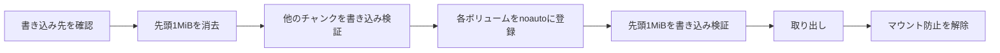

<div align="center">

<h1>kakikomi</h1>

<strong>ディスクイメージをフロッピー、Zipディスク、USBメモリ、ハードディスクにチャンクごとに検証しながら書き込み、システムにマウントさせません。</strong>

[English](README.md) | 日本語 | [简体中文](README.zh-Hans.md) | [繁體中文 (香港)](README.zh-HK.md)

[](https://github.com/gufranco/kakikomi/actions/workflows/ci.yml)
[](https://github.com/gufranco/kakikomi/releases/latest)
[](LICENSE)

<p align="center">
  <a href="#quick-start"><strong>クイックスタート</strong></a> |
  <a href="#never-mounted">マウントさせない仕組み</a> |
  <a href="#development">開発</a>
</p>

</div>

コマンドは1つ、テストは305件、シェルのモジュールは15個で、POSIXシステム以外に実行時の依存はありません。`kakikomi`はディスクへの「書き込み」です。姉妹ツールの[kiyome](https://github.com/gufranco/kiyome)は、ディスクを消去して誤ったビット線を調べます。

---

```console
$ kakikomi debian.img.xz /dev/disk6
Computing the image's SHA-256.

Image:  debian.img.xz
        xz, 16.0 MiB (16777216 bytes)
        SHA-256 dab1a2aef901faed28711e7cfa3fa8ce52cfee0a9b05d71b3d4feb95fb846bb0
Target: /dev/disk6, 16.0 MiB, DISK IMAGE
        Everything on it is replaced, including:
          +16.8 MB disk6

Type disk6 to write, or anything else to stop: disk6
Unmounting /dev/disk6...
Disk unmounted
Measuring /dev/disk6 before writing it, so every limit comes from this disk.
Measured read: 232800 KiB/s, 27ms to reach a sector, allowing 3x that.
Measured write: 83142 KiB/s, 29ms to reach a sector, allowing 3x that.
Blanking the first 16.0 MiB so /dev/disk6 cannot mount until the end.
Writing  50%  86.0 MiB/s  0m00s left
The image holds no volume macOS would mount.
Writing the first 16.0 MiB last.
Writing 100%  34.7 MiB/s  0m00s left
Wrote and verified every chunk of the image.
Reading back all 16.0 MiB to compare with the image.
Validated: /dev/disk6 matches the image, SHA-256
        dab1a2aef901faed28711e7cfa3fa8ce52cfee0a9b05d71b3d4feb95fb846bb0
Ejecting /dev/disk6...
Ejected. /dev/disk6 is safe to remove.
```

<a id="quick-start"></a>

## クイックスタート

### 前提条件

| ツール | 用途 | インストール |
|:-----|:----|:--------|
| POSIX `sh`、`dd`、`cmp`、`od` | ツール本体 | macOSとLinuxにプリインストールされています。`bash`は不要です |
| `gzip`、`xz`、`zstd`、`bzip2` | 圧縮イメージ | 書き込む形式の分だけ必要です |
| `bsdtar`または`7z` | `.zip`イメージとWindowsのISO | Linuxでは`libarchive-tools`または`p7zip-full` |
| `qemu-img` | `.vhd`、`.vhdx`、`.vmdk`、`.qcow2` | `brew install qemu`または`apt install qemu-utils` |
| `mtools`、`wimlib` | WindowsのISOと`kakikomi format` | Homebrewのformulaで入ります。Linuxでは`apt install mtools wimtools` |

### インストール

```bash
brew install gufranco/tap/kakikomi
```

ソースからもインストールできます。

```bash
git clone https://github.com/gufranco/kakikomi.git
cd kakikomi
make install
```

`make install`はツールとmanページ、bash・zsh・fishの補完を`~/.local`の下にコピーし、`kakikomi`を`~/.local/bin`に置きます。場所は`PREFIX`で変えられます。Homebrewのformulaも同じファイルをインストールします。

### 確認

```console
$ kakikomi doctor
dd                 ok       /bin/dd, bsd
cmp                ok       /usr/bin/cmp, bsd
od                 ok       /usr/bin/od, bsd
awk                ok       /usr/bin/awk, bsd 20200816
sed                ok       /usr/bin/sed, bsd
sudo               ok       /usr/bin/sudo
sha256sum|shasum   ok       /sbin/sha256sum, bsd 1.0
diskutil           ok       /usr/sbin/diskutil
hdiutil            ok       /usr/bin/hdiutil
curl               ok       /usr/bin/curl
gzip               ok       /usr/bin/gzip
xz                 ok       /opt/homebrew/bin/xz
zstd               ok       /opt/homebrew/bin/zstd
bzip2              ok       /usr/bin/bzip2
bsdtar|7z          ok       /usr/bin/bsdtar
qemu-img           ok       /opt/homebrew/bin/qemu-img
mcopy              ok       /opt/homebrew/bin/mcopy
wimlib-imagex      ok       /opt/homebrew/bin/wimlib-imagex
md5sum|md5         ok       /sbin/md5sum, bsd 1.0
sha512sum|shasum   ok       /sbin/sha512sum, bsd 1.0
b2sum|openssl      missing  checks a published BLAKE2b checksum
```

## 使い方

| コマンド | 用途 |
|:--------|:--------|
| `kakikomi [options] <image\|url\|device> [target...]` | イメージを1台以上のディスクに書き込みます。書き込み先を省くと、選べるリムーバブルディスクを一覧表示します |
| `kakikomi <windows.iso> <target>` | WindowsのインストールISOを、UEFIで起動できるFAT32のUSBメモリとして配置します |
| `kakikomi format [options] <target> [fat32\|exfat\|fat\|floppy] [LABEL]` | クイックフォーマット。新しいファイルシステムの構造だけを書き込みます |
| `kakikomi --release` | 実行時に残ったマウント防止の設定を取り除きます |
| 引数なしの`kakikomi` | ターミナルで実行すると、何をするかを尋ね、続けて必要な値を順に尋ねます |
| `kakikomi doctor` | kakikomiが必要とするツールと、インストール状況を一覧表示します |
| `kakikomi version`、`kakikomi help` | バージョンまたは使い方の全文を表示します |

| 入力 | 読み方 |
|:-------|:---------------|
| `.img`、`.iso`、`.bin`、`.raw`、`.dsk`、`.ima` | そのまま |
| `.gz`、`.xz`、`.zst`、`.bz2` | ストリームで読み、ディスクには展開しません |
| イメージを1つだけ含む`.zip` | `bsdtar`でストリームとして読みます |
| `.dmg`、`.vhd`、`.vhdx`、`.vmdk`、`.qcow2` | 空き容量を確認してから、先にrawへ変換します |
| `http://`または`https://`のURL | 再開可能なダウンロードのあと、ファイルとして読みます |
| `/dev/...`、または `/Volumes/OLD` のようなマウント中のボリューム | ドライブ全体から複製し、そのドライブもマウントさせません |

| オプション | 効果 |
|:-------|:-------|
| `--verify`、`--no-verify` | 最後にディスク全体をイメージのSHA-256と比較するか、省くか。指定がなければ端末で確認されます |
| `--delete`、`--no-delete` | すべてのディスクの検証が通ったらイメージをゴミ箱に移すか、残すか。読み戻していない場合は無視されます |
| `--again` | 次に挿したディスクにも同じイメージを書き込みます |
| `--reinsert`、`--no-reinsert` | 取り出したあと、ディスクが戻るのを待って再度比較します |
| `--zero-tail` | 大きいディスクで、イメージより後ろの領域を消去します |
| `--sha256 HASH` | イメージがこの SHA-256 と一致しなければ止めます。指定しない場合はイメージの隣に公開されたチェックサムファイルを読みます。[公開チェックサム](#published-checksums)を参照 |
| `--allow-internal` | 内蔵ディスクを許可します。動作中のシステムがあるディスクは常に拒否されます |
| `--keep-guard` | 実行後もfstabの設定を残し、このMacがそのディスクを今後もマウントしないようにします |
| `--raw` | WindowsのISOをFAT32に配置せず、そのまま書き込みます |

`--sha256=HASH`の形も使え、`--`でオプションが終わります。環境変数`KAKIKOMI_VERIFY`、`KAKIKOMI_DELETE`、`KAKIKOMI_AGAIN`、`KAKIKOMI_REINSERT`、`KAKIKOMI_ZERO_TAIL`、`KAKIKOMI_SHA256`、`KAKIKOMI_ALLOW_INTERNAL`、`KAKIKOMI_KEEP_GUARD`、`KAKIKOMI_MODE=raw`も`y`か`n`で同じ設定になり、コマンドラインのオプションが優先されます。

```bash
kakikomi debian.img.xz /dev/disk4 /dev/disk5     # two sticks at once
kakikomi debian.img.xz /Volumes/USB              # a mounted volume stands for its whole disk
kakikomi https://example.org/os.img.gz            # pick the target from a list
kakikomi /dev/disk4 /dev/disk5                    # clone disk4 onto disk5
kakikomi /Volumes/OLD /Volumes/NEW               # the same clone, named by volume
kakikomi --again game.ima /dev/disk6              # a batch of floppies
kakikomi format /dev/disk4 exfat MEDIA
```

ディスクはデバイス名（`/dev/disk4` など）でも、そのディスクからマウントされたボリューム（`/Volumes/USB` など）でも指定できます。kakikomi はボリュームの背後にあるディスク全体を突き止めます。コピー元、書き込み先、format のどれでも同じです。

kakikomiはファミリー共通のコマンドライン規約に従います。内容は[FAMILY.md](FAMILY.md)にあります。

<a id="never-mounted"></a>

## マウントさせない仕組み

macOSはFATのボリュームをマウントすると、ほんの一瞬でも`.fseventsd`、`.Spotlight-V100`、`._`のファイルを書き込みます。そのため、レトロな機器のために書いたディスクが変わって戻ってきます。kakikomiはシステムを寄せ付けません。



| 手順 | 詳細 |
|:-----|:-------|
| 最後までマウントできるものがない | 先頭1MiBが空なので、パーティションテーブルもブートセクタもなく、DiskArbitrationもudisksもボリュームを見つけられません |
| 現れる前に登録 | macOSでは、`-nomount`で接続したヘッダーだけのコピーから各ボリュームのUUIDを読み、`/etc/fstab`に`noauto`として書きます。Linuxではそのデバイスに`UDISKS_IGNORE`のudevルールを置きます |
| 監視 | 実行中にマウントが見つかると失敗とし、システムが作ったファイルを示します |
| 確認 | `--reinsert`は、抜き差ししたあとにディスク全体を読み戻します |

途中で止めた実行でも先頭1MiBは空のままなので、書きかけのディスクもマウントできません。

## 最初の問題で止まる

各チャンクは書き込み、読み戻し、比較してから次へ進みます。kakikomiはまずディスク自体の速度を測り、その値から各転送の期限を決めます。不一致、停止、デバイスの消失があるとそのディスクを止めて取り出し、誤ったビット線を表示します。

| ドライブ | 扱い |
|:------|:----------|
| Zip、Jaz、PocketZip | 期限を短くし、再試行しません。停止はヘッドのずれとみなします。ずれたヘッドは次に入れたカートリッジを傷めます |
| フロッピー、SuperDisk | 再試行しません。ソフトウェアで取り出せないドライブなので、ディスクを抜くまで待ちます |
| その他 | チャンクごとに3回試してから止めます |

書き込み先が複数あるときは、ディスクごとに別のワーカーが書き込み、1台の失敗が他を止めることはありません。

<a id="published-checksums"></a>

## 公開チェックサム

ほとんどのイメージには、同じダウンロードページからチェックサムファイルが配布されています。kakikomi は書き込む前にイメージの隣でそれを探し、イメージが一致しなければ止めます。URL で指定したイメージでは、同じサーバーのディレクトリにもよく使われる名前を問い合わせます。

| 探すもの | 例 |
|:---------|:---|
| イメージの名前を持つファイル | `debian.iso.sha256`、`debian.iso.md5`、`debian.sha512`、`debian.iso.DIGESTS`、`debian.iso.json` |
| 隣にある一覧 | `SHA256SUMS`、`SHA512SUMS (1)`、`sha256sum.txt`、`b2sums.txt`、`MD5SUMS`、`CHECKSUM`、`Fedora-...-CHECKSUM`、`release.sfv` |

| 形式 | 行の例 |
|:-----|:-------|
| `sha256sum`、`md5sum`、`b2sum`、`shasum` | `9f2c...e1  debian.iso`、バイナリモードでは `*debian.iso` |
| BSD と `--tag` | `SHA256 (debian.iso) = 9f2c...e1` |
| OpenSSL | `SHA2-256(debian.iso)= 9f2c...e1` |
| 署名付きの一覧 | PGP 署名で包まれた Fedora や Debian のファイル。署名の枠は読み飛ばします |
| Gentoo の `DIGESTS` | 普通の行の上にある `# SHA512 HASH` 見出し |
| Windows | `CertUtil -hashfile` と PowerShell の `Get-FileHash`、表形式とリスト形式の両方 |
| SFV | `debian.iso CBF43926` |
| ダイジェストだけ | イメージの名前を持ち、ハッシュだけを書いたファイル。大文字小文字、Unix と Windows の改行を問いません |

MD5、SHA-1、SHA-224、SHA-256、SHA-384、SHA-512、SHA3、BLAKE2b、CRC32 を、行のラベル、上の見出し、ファイル名、ダイジェストの長さから見分けます。複数が公開されていれば一つだけ確かめます。どのみち計算する SHA-256 を優先し、なければここにあるツールで計算できる最も強いものを使います。圧縮イメージはファイルそのものか展開した中身のどちらかに一致すればよいので、`debian.img` を挙げた一覧は `debian.img.xz` にも使えます。

| 結果 | どうなるか |
|:-----|:-----------|
| 一致 | `The image matches the SHA-512 published in Downloads/SHA512SUMS.` と表示して書き込みを続けます |
| 不一致 | どのディスクにも触れる前に止まり、期待値と計算したダイジェストを表示します |
| 公開されたアルゴリズムを計算できるツールがない | 止まって、入れるべきツールを示します |
| どのイメージも指さない単独のダイジェスト、たとえばハッシュだけの `sha256.txt` | 別のダウンロードのものかもしれないので、不一致は警告にとどめます |

署名付き一覧の PGP 署名は検証しません。`--sha256 HASH` を指定すると、探す代わりにその値を使います。

## Windowsのインストーラー

WindowsのISOはそのまま書いてもUSBからは起動しません。kakikomiはそれを検出し、すべてのファイルを含むFAT32パーティション1つのMBRディスクを作り、4GiBを超える`install.wim`は`wimlib`で分割します。ファイルは`mtools`でコピーするので書き込み先はマウントされず、ボリュームを書き込む前に全ファイルを読み戻して比較します。できたものはUEFIのマシンで起動します。

<a id="portability"></a>

## 移植性

すべてPOSIX `sh`で書かれ、ShellCheckの`-o all`で指摘ゼロ、無効化したチェックもありません。テストはmacOSの`/bin/sh`と`dash`、システムの bash 3.2 と zsh、Homebrew の最新の bash と zsh、そして特権コンテナ内のUbuntuの`dash`、`bash`、`bash --posix`、`zsh`で実行します。

Linux の GNU coreutils と uutils coreutils、macOS 標準のツール、その新しい Homebrew 版、Homebrew の uutils ツールという、よく使われる 5 つのツールセットのどれでも動きます。macOS 標準のツールのうち Homebrew に新しい版があるものは、bash と zsh から openssl、perl、bsdtar、gzip、bzip2 まで、両方の版でテストします。CI はそれぞれで全テストを実行し、`kakikomi doctor` は主要ツールの系統とバージョン（`gnu 9.7`、`uutils 0.12.0`、`bsd 20200816` など）を表示するので、不具合報告でどのツールが動いたかが分かります。

<a id="development"></a>

## 開発

| コマンド | 説明 |
|:--------|:------------|
| `make lint` | すべてのスクリプトと補完にShellCheck、manページにmandocを実行し、関数が二重に定義されていないことを確認します |
| `make test` | システムの`sh`で305件の`bats`テスト |
| `make test-all` | インストール済みのすべてのシェルで同じテスト |
| `make test-linux` | Macから、特権付きUbuntuコンテナで同じテスト |
| `make coverage` | このMacと同じコンテナでbashcovによる行カバレッジを測定して統合します。CIは100%を必須にします |

テストは`hdiutil`や`losetup`でファイルを使ったディスクを接続して実際に書き込み、Linuxでは`dmsetup`でI/Oエラーを注入します。CIはUbuntuとmacOSで実行します。`main`へのpushごとにsemantic-releaseが動き、`feat`か`fix`のコミットがあればリリースを公開し、[`lib/core.sh`](lib/core.sh)の`KAKIKOMI_VERSION`とCHANGELOGを更新して、Homebrewのformulaも更新します。

## ライセンス

[MIT](LICENSE)
