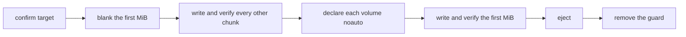

<div align="center">

<h1>kakikomi</h1>

<strong>Write disk images to floppies, Zip disks, USB sticks and hard disks, verified chunk by chunk, without letting the system mount them.</strong>

English | [日本語](README.ja.md) | [简体中文](README.zh-Hans.md) | [繁體中文 (香港)](README.zh-HK.md)

[](https://github.com/gufranco/kakikomi/actions/workflows/ci.yml)
[](https://github.com/gufranco/kakikomi/releases)
[](LICENSE)
[](#portability)

<p align="center">
  <a href="#quick-start"><strong>Quick start</strong></a> |
  <a href="#never-mounted">Never mounted</a> |
  <a href="#development">Development</a>
</p>

</div>

One command, 297 tests, 15 shell modules, and no runtime dependency beyond a POSIX system. `kakikomi` is 書き込み, Japanese for writing data to a disk. Its companion [kiyome](https://github.com/gufranco/kiyome) wipes a disk and checks it for bad bit lines.

---

```console
$ kakikomi debian.img.xz /dev/disk6
Computing the image's SHA-256.

Image:  debian.img.xz
        xz, 16.0 MiB (16777216 bytes)
        SHA-256 dab1a2aef901faed28711e7cfa3fa8ce52cfee0a9b05d71b3d4feb95fb846bb0
Target: /dev/disk6, 16.0 MiB, DISK IMAGE
        Everything on it is replaced, including:
          +16.8 MB disk6

Type disk6 to write, or anything else to stop: disk6
Unmounting /dev/disk6...
Disk unmounted
Measuring /dev/disk6 before writing it, so every limit comes from this disk.
Measured read: 232800 KiB/s sustained, 27ms to reach a sector, allowing 3x that before stopping.
Measured write: 83142 KiB/s sustained, 29ms to reach a sector, allowing 3x that before stopping.
Blanking the first 16.0 MiB so nothing on /dev/disk6 is mountable until the very end.
Writing  50%  86.0 MiB/s  0m00s left
The image holds no volume macOS would mount.
Writing the first 16.0 MiB last.
Writing 100%  34.7 MiB/s  0m00s left
Wrote and verified every chunk of the image.
Reading back all 16.0 MiB to compare with the image.
Validated: /dev/disk6 matches the image, SHA-256 dab1a2aef901faed28711e7cfa3fa8ce52cfee0a9b05d71b3d4feb95fb846bb0
Ejecting /dev/disk6...
Ejected. /dev/disk6 is safe to remove.
```

<a id="quick-start"></a>

## Quick start

### Prerequisites

| Tool | Why | Install |
|:-----|:----|:--------|
| POSIX `sh`, `dd`, `cmp`, `od` | The tools themselves | Preinstalled on macOS and Linux. `bash` is not required |
| `gzip`, `xz`, `zstd`, `bzip2` | Compressed images | Only for the formats you write |
| `bsdtar` or `7z` | `.zip` images and Windows ISOs | `libarchive-tools` or `p7zip-full` on Linux |
| `qemu-img` | `.vhd`, `.vhdx`, `.vmdk`, `.qcow2` | `brew install qemu` or `apt install qemu-utils` |
| `mtools`, `wimlib` | Windows ISOs and `kakikomi format` | Installed with the Homebrew formula; `apt install mtools wimtools` |

### Install

```bash
brew install gufranco/tap/kakikomi
```

Or from source:

```bash
git clone https://github.com/gufranco/kakikomi.git
cd kakikomi
make install
```

`make install` copies the tool, its man page and its bash, zsh and fish completions under `~/.local`, and puts `kakikomi` in `~/.local/bin`; set `PREFIX` to change that. The Homebrew formula installs the same files.

### Verify

```console
$ kakikomi doctor
dd                 ok       /bin/dd, bsd
cmp                ok       /usr/bin/cmp, bsd
od                 ok       /usr/bin/od, bsd
awk                ok       /usr/bin/awk, bsd 20200816
sed                ok       /usr/bin/sed, bsd
sudo               ok       /usr/bin/sudo
sha256sum|shasum   ok       /sbin/sha256sum, bsd 1.0
diskutil           ok       /usr/sbin/diskutil
hdiutil            ok       /usr/bin/hdiutil
curl               ok       /usr/bin/curl
gzip               ok       /usr/bin/gzip
xz                 ok       /opt/homebrew/bin/xz
zstd               ok       /opt/homebrew/bin/zstd
bzip2              ok       /usr/bin/bzip2
bsdtar|7z          ok       /usr/bin/bsdtar
qemu-img           ok       /opt/homebrew/bin/qemu-img
mcopy              ok       /opt/homebrew/bin/mcopy
wimlib-imagex      ok       /opt/homebrew/bin/wimlib-imagex
md5sum|md5         ok       /sbin/md5sum, bsd 1.0
sha512sum|shasum   ok       /sbin/sha512sum, bsd 1.0
b2sum|openssl      missing  checks a published BLAKE2b checksum
```

## Usage

| Command | Purpose |
|:--------|:--------|
| `kakikomi [options] <image\|url\|device> [target...]` | Write an image to one or more disks. With no target, lists the removable disks to pick from |
| `kakikomi <windows.iso> <target>` | Lay a Windows installer ISO out as a UEFI-bootable FAT32 stick |
| `kakikomi format [options] <target> [fat32\|exfat\|fat\|floppy] [LABEL]` | Quick format: write only the new filesystem's structures |
| `kakikomi --release` | Remove the mount guards a run left behind |
| `kakikomi` with no arguments | Ask what to do, then for each value, when run in a terminal |
| `kakikomi doctor` | List the tools kakikomi needs and whether they are installed |
| `kakikomi version`, `kakikomi help` | Print the version or the full usage page |

| Source | How it is read |
|:-------|:---------------|
| `.img`, `.iso`, `.bin`, `.raw`, `.dsk`, `.ima` | Directly |
| `.gz`, `.xz`, `.zst`, `.bz2` | Streamed, never extracted to disk |
| `.zip` holding one image | Streamed with `bsdtar` |
| `.dmg`, `.vhd`, `.vhdx`, `.vmdk`, `.qcow2` | Converted to raw first, after a free-space check |
| `http://` or `https://` URL | Downloaded with resume, then read as a file |
| `/dev/...`, or a mounted volume such as `/Volumes/OLD` | Cloned from the whole drive, which is also kept unmounted |

| Option | Effect |
|:-------|:-------|
| `--verify`, `--no-verify` | Compare the whole disk with the image's SHA-256 at the end, or skip it. Asked in a terminal when not given |
| `--delete`, `--no-delete` | Move the image to the Trash once every disk validated, or keep it. Ignored when nothing was read back |
| `--again` | Write the same image to the next disk you insert |
| `--reinsert`, `--no-reinsert` | After ejecting, wait for the disk to come back and compare it again |
| `--zero-tail` | Blank the space past the image on a larger disk |
| `--sha256 HASH` | Stop unless the image matches this SHA-256. Without it, a checksum file published next to the image is read, see [Published checksums](#published-checksums) |
| `--allow-internal` | Allow an internal disk. The disk holding the running system is always refused |
| `--keep-guard` | Keep the fstab guard after the run, so this Mac never mounts that disk |
| `--raw` | Write a Windows ISO byte for byte instead of laying it out as FAT32 |

`--sha256=HASH` works too, and `--` ends the options. The environment variables `VERIFY`, `DELETE`, `AGAIN`, `REINSERT`, `ZERO_TAIL`, `SHA256`, `ALLOW_INTERNAL`, `KEEP_GUARD` and `MODE=raw` set the same options, with `y` or `n`; an option on the command line wins.

```bash
kakikomi debian.img.xz /dev/disk4 /dev/disk5     # two sticks at once
kakikomi debian.img.xz /Volumes/USB              # a mounted volume stands for its whole disk
kakikomi https://example.org/os.img.gz            # pick the target from a list
kakikomi /dev/disk4 /dev/disk5                    # clone disk4 onto disk5
kakikomi /Volumes/OLD /Volumes/NEW               # the same clone, named by volume
kakikomi --again game.ima /dev/disk6              # a batch of floppies
kakikomi format /dev/disk4 exfat MEDIA
```

A disk is named by its device, such as `/dev/disk4`, or by any volume mounted from it, such as `/Volumes/USB`; kakikomi works out the whole disk behind the volume, for the image, the target and the format command alike.

kakikomi follows the shared command-line contract of its family, described in [FAMILY.md](FAMILY.md).

<a id="never-mounted"></a>

## Never mounted

macOS writes `.fseventsd`, `.Spotlight-V100` and `._` files onto any FAT volume it mounts, even for a moment, so a disk written for a retro machine comes back changed. kakikomi keeps the system out:



| Step | Detail |
|:-----|:-------|
| Nothing mountable until the end | With the first MiB blank there is no partition table or boot sector, so neither DiskArbitration nor udisks finds a volume |
| Declared before it appears | macOS: each volume's UUID goes into `/etc/fstab` as `noauto`, read from a header-only copy attached with `-nomount`. Linux: a `UDISKS_IGNORE` udev rule for the device |
| Watched | A mount seen during the run fails it and names the files the system created |
| Proven | `--reinsert` reads the whole disk back after you unplug and replug it |

A run stopped halfway leaves the first MiB blank, so the half-written disk is not mountable either.

## Stops at the first problem

Every chunk is written, read back, and compared before the next one. kakikomi first times the disk on itself, then gives each transfer a deadline from that measurement. A mismatch, a stall or a vanished device stops that disk, ejects it, and prints which bit lines were wrong.

| Drive | Treatment |
|:------|:----------|
| Zip, Jaz, PocketZip | Tighter deadlines and no retries; a stall is treated as a mistracking head, which damages the next cartridge it meets |
| Floppy, SuperDisk | No retries, and the run waits for you to remove the disk since these drives have no software eject |
| Everything else | Three attempts per chunk, then a stop |

With several targets, each disk is written by its own worker, and a fault on one does not stop the others.

<a id="published-checksums"></a>

## Published checksums

Most images come with a checksum file from the same download page. Before anything is written, kakikomi looks for one next to the image and stops when the image does not match it. For an image given as a URL, it also asks the same server directory for the usual names.

| Looked for | Examples |
|:-----------|:---------|
| A file named after the image | `debian.iso.sha256`, `debian.iso.md5`, `debian.sha512`, `debian.iso.DIGESTS`, `debian.iso.json` |
| A list next to it | `SHA256SUMS`, `SHA512SUMS (1)`, `sha256sum.txt`, `b2sums.txt`, `MD5SUMS`, `CHECKSUM`, `Fedora-...-CHECKSUM`, `release.sfv` |

| Format | Example line |
|:-------|:-------------|
| `sha256sum`, `md5sum`, `b2sum`, `shasum` | `9f2c...e1  debian.iso`, or `*debian.iso` in binary mode |
| BSD and `--tag` | `SHA256 (debian.iso) = 9f2c...e1` |
| OpenSSL | `SHA2-256(debian.iso)= 9f2c...e1` |
| Signed lists | Fedora and Debian files wrapped in a PGP signature; the armor is skipped |
| Gentoo `DIGESTS` | `# SHA512 HASH` headers above plain lines |
| Windows | `CertUtil -hashfile` and PowerShell `Get-FileHash`, in table or list form |
| SFV | `debian.iso CBF43926` |
| A bare digest | A file named after the image holding only the hash, in any case, with Unix or Windows line endings |

MD5, SHA-1, SHA-224, SHA-256, SHA-384, SHA-512, SHA3, BLAKE2b and CRC32 are recognized, by a label on the line, a header above it, the file name, or the digest's length. When several are published, kakikomi checks one: SHA-256 first, since it is computed anyway, then the strongest one a tool here can compute. A compressed image matches either the file or its decompressed contents, so a list that names `debian.img` covers `debian.img.xz`.

| Result | What happens |
|:-------|:-------------|
| Matches | `The image matches the SHA-512 published in Downloads/SHA512SUMS.`, then the write goes on |
| Does not match | The run stops before any disk is touched, printing the expected and the computed digest |
| No tool computes the published algorithm | The run stops and names the tool to install |
| A loose digest that names no image, such as a `sha256.txt` holding only a hash | A mismatch is a warning, since the file may belong to another download |

The PGP signature on a signed list is not verified. `--sha256 HASH` replaces the search with the digest you give.

## Windows installers

A Windows ISO written byte for byte does not boot from USB. kakikomi detects one and builds an MBR disk with a single FAT32 partition holding every file, splitting an `install.wim` over 4 GiB with `wimlib`. The files are copied with `mtools`, so the target is never mounted, and every file is read back and compared before the volume is written. The result boots on UEFI machines.

<a id="portability"></a>

## Portability

Everything is POSIX `sh` with ShellCheck `-o all` at zero findings and no disabled checks. The suites run on macOS under `/bin/sh` and `dash`, the system's bash 3.2 and zsh, and Homebrew's current bash and zsh, and on Ubuntu under `dash`, `bash`, `bash --posix` and `zsh` in a privileged container.

Every run works on the five toolsets in common use: Linux with GNU or uutils coreutils, and macOS with the tools it ships, Homebrew's newer builds of them, or Homebrew's uutils tools. Every tool macOS ships that Homebrew also builds newer, from bash and zsh to openssl, perl, bsdtar, gzip and bzip2, is tested in both builds. CI runs the whole suite on each, and `kakikomi doctor` names the flavor and version of every core tool, such as `gnu 9.7`, `uutils 0.12.0` or `bsd 20200816`, so a bug report says which tools ran.

<a id="development"></a>

## Development

| Command | Description |
|:--------|:------------|
| `make lint` | ShellCheck on every script and completion, mandoc on the man page, and a check that no function is defined twice |
| `make test` | The 297 `bats` tests under the system `sh` |
| `make test-all` | The same tests under every installed shell |
| `make test-linux` | The same tests in a privileged Ubuntu container, from a Mac |
| `make coverage` | bashcov line coverage on this Mac and in that container, merged, with a 100% gate CI enforces |

The tests attach file-backed disks with `hdiutil` or `losetup`, write to them for real, and inject I/O errors with `dmsetup` on Linux. CI runs them on Ubuntu and macOS. Every push to `main` runs semantic-release: a `feat` or `fix` commit publishes a release, updates `KAKIKOMI_VERSION` in [`lib/core.sh`](lib/core.sh) and the CHANGELOG, and bumps the Homebrew formula.

## License

[MIT](LICENSE)
