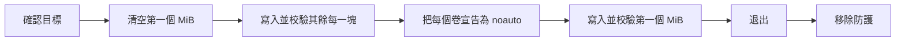

<div align="center">

<h1>kakikomi</h1>

<strong>把磁碟映像寫入軟碟、Zip 碟、USB 手指和硬碟，逐塊校驗，而且絕不讓系統掛載。</strong>

[English](README.md) | [日本語](README.ja.md) | [简体中文](README.zh-Hans.md) | 繁體中文 (香港)

[](https://github.com/gufranco/kakikomi/actions/workflows/ci.yml)
[](https://github.com/gufranco/kakikomi/releases/latest)
[](LICENSE)

<p align="center">
  <a href="#quick-start"><strong>快速開始</strong></a> |
  <a href="#never-mounted">絕不掛載</a> |
  <a href="#development">開發</a>
</p>

</div>

一條指令，305 個測試，15 個 shell 模組，除了 POSIX 系統之外沒有任何執行時依賴。`kakikomi` 是日文「書き込み」，意思是把資料寫入磁碟。姊妹工具 [kiyome](https://github.com/gufranco/kiyome) 負責抹除磁碟並檢查出錯的位線。

---

```console
$ kakikomi debian.img.xz /dev/disk6
Computing the image's SHA-256.

Image:  debian.img.xz
        xz, 16.0 MiB (16777216 bytes)
        SHA-256 dab1a2aef901faed28711e7cfa3fa8ce52cfee0a9b05d71b3d4feb95fb846bb0
Target: /dev/disk6, 16.0 MiB, DISK IMAGE
        Everything on it is replaced, including:
          +16.8 MB disk6

Type disk6 to write, or anything else to stop: disk6
Unmounting /dev/disk6...
Disk unmounted
Measuring /dev/disk6 before writing it, so every limit comes from this disk.
Measured read: 232800 KiB/s, 27ms to reach a sector, allowing 3x that.
Measured write: 83142 KiB/s, 29ms to reach a sector, allowing 3x that.
Blanking the first 16.0 MiB so /dev/disk6 cannot mount until the end.
Writing  50%  86.0 MiB/s  0m00s left
The image holds no volume macOS would mount.
Writing the first 16.0 MiB last.
Writing 100%  34.7 MiB/s  0m00s left
Wrote and verified every chunk of the image.
Reading back all 16.0 MiB to compare with the image.
Validated: /dev/disk6 matches the image, SHA-256
        dab1a2aef901faed28711e7cfa3fa8ce52cfee0a9b05d71b3d4feb95fb846bb0
Ejecting /dev/disk6...
Ejected. /dev/disk6 is safe to remove.
```

<a id="quick-start"></a>

## 快速開始

### 先決條件

| 工具 | 用途 | 安裝 |
|:-----|:----|:--------|
| POSIX `sh`、`dd`、`cmp`、`od` | 工具本身 | macOS 和 Linux 已預裝，不需要 `bash` |
| `gzip`、`xz`、`zstd`、`bzip2` | 壓縮映像 | 只在寫入對應格式時需要 |
| `bsdtar`、`7z` 或 `7zz` | `.zip` 映像和 Windows ISO | Linux 上為 `libarchive-tools` 或 `7zip` |
| `qemu-img` | `.vhd`、`.vhdx`、`.vmdk`、`.qcow2` | `brew install qemu` 或 `apt install qemu-utils` |
| `mtools`、`wimlib` | Windows ISO 和 `kakikomi format` | 隨 Homebrew formula 安裝；`apt install mtools wimtools` |

### 安裝

```bash
brew install gufranco/tap/kakikomi
```

或從原始碼安裝：

```bash
git clone https://github.com/gufranco/kakikomi.git
cd kakikomi
make install
```

`make install` 把工具、man 說明頁以及 bash、zsh、fish 自動補全複製到 `~/.local` 之下，並把 `kakikomi` 放進 `~/.local/bin`；設定 `PREFIX` 可以改變位置。Homebrew formula 安裝的是相同的檔案。

### 驗證

```console
$ kakikomi doctor
dd                 ok       /bin/dd, bsd
cmp                ok       /usr/bin/cmp, bsd
od                 ok       /usr/bin/od, bsd
awk                ok       /usr/bin/awk, bsd 20200816
sed                ok       /usr/bin/sed, bsd
sudo               ok       /usr/bin/sudo
sha256sum|shasum   ok       /sbin/sha256sum, bsd 1.0
diskutil           ok       /usr/sbin/diskutil
hdiutil            ok       /usr/bin/hdiutil
curl               ok       /usr/bin/curl
gzip               ok       /usr/bin/gzip
xz                 ok       /opt/homebrew/bin/xz
zstd               ok       /opt/homebrew/bin/zstd
bzip2              ok       /usr/bin/bzip2
bsdtar|7z          ok       /usr/bin/bsdtar
qemu-img           ok       /opt/homebrew/bin/qemu-img
mcopy              ok       /opt/homebrew/bin/mcopy
wimlib-imagex      ok       /opt/homebrew/bin/wimlib-imagex
md5sum|md5         ok       /sbin/md5sum, bsd 1.0
sha512sum|shasum   ok       /sbin/sha512sum, bsd 1.0
b2sum|openssl      missing  checks a published BLAKE2b checksum
```

## 用法

| 指令 | 作用 |
|:--------|:--------|
| `kakikomi [options] <image\|url\|device> [target...]` | 把映像寫入一個或多個磁碟。不指定目標時，列出可選的可移除磁碟 |
| `kakikomi <windows.iso> <target>` | 把 Windows 安裝 ISO 佈置成可用 UEFI 開機的 FAT32 手指 |
| `kakikomi format [options] <target> [fat32\|exfat\|fat\|floppy] [LABEL]` | 快速格式化：只寫入新檔案系統的結構 |
| `kakikomi release` | 移除中斷的執行留下的掛載防護 |
| 不帶參數的 `kakikomi` | 在終端機執行時，先問要做甚麼，再逐項詢問 |
| `kakikomi doctor` | 列出 kakikomi 需要的工具及是否已安裝 |
| `kakikomi version`、`kakikomi help` | 顯示版本或完整用法 |

| 來源 | 讀取方式 |
|:-------|:---------------|
| `.img`、`.iso`、`.bin`、`.raw`、`.dsk`、`.ima` | 直接讀取 |
| `.gz`、`.xz`、`.zst`、`.bz2` | 串流讀取，從不解壓到磁碟 |
| 內含單一映像的 `.zip` | 用 `bsdtar` 串流讀取 |
| `.dmg`、`.vhd`、`.vhdx`、`.vmdk`、`.qcow2` | 先檢查剩餘空間，再轉換為原始映像 |
| `http://` 或 `https://` 網址 | 以可續傳方式下載，然後當作檔案讀取 |
| `/dev/...`，或 `/Volumes/OLD` 這類已掛載的卷 | 從整個磁碟機複製，來源同樣保持不掛載 |

| 選項 | 效果 |
|:-------|:-------|
| `--verify`、`--no-verify` | 最後把整個磁碟與映像的 SHA-256 比對，或略過。未指定時在終端機詢問 |
| `--delete`、`--no-delete` | 所有磁碟校驗通過後把映像移到垃圾桶，或保留。沒有回讀時會忽略 |
| `--again` | 把同一映像寫入你插入的下一個磁碟 |
| `--reinsert`、`--no-reinsert` | 退出後等待磁碟重新插入，再比對一次 |
| `--zero-tail` | 在較大的磁碟上清空映像之後的空間 |
| `--sha256 HASH` | 映像與這個 SHA-256 不吻合就停止。不指定時，讀取映像旁邊發佈的校驗和檔案，見[發佈的校驗和](#published-checksums) |
| `--allow-internal` | 允許內置磁碟。正在運行的系統所在的磁碟一定會被拒絕 |
| `--keep-guard` | 執行後保留 fstab 防護，令這部 Mac 永不掛載該磁碟 |
| `--raw` | 把 Windows ISO 逐個 byte 原樣寫入，而不是佈置成 FAT32 |

也可以寫成 `--sha256=HASH`，`--` 表示選項結束。環境變數 `KAKIKOMI_VERIFY`、`KAKIKOMI_DELETE`、`KAKIKOMI_AGAIN`、`KAKIKOMI_REINSERT`、`KAKIKOMI_ZERO_TAIL`、`KAKIKOMI_SHA256`、`KAKIKOMI_ALLOW_INTERNAL`、`KAKIKOMI_KEEP_GUARD` 和 `KAKIKOMI_MODE=raw` 以 `y` 或 `n` 設定同樣的選項，命令列上的選項優先。

```bash
kakikomi debian.img.xz /dev/disk4 /dev/disk5     # two sticks at once
kakikomi debian.img.xz /Volumes/USB              # a mounted volume stands for its whole disk
kakikomi https://example.org/os.img.gz            # pick the target from a list
kakikomi /dev/disk4 /dev/disk5                    # clone disk4 onto disk5
kakikomi /Volumes/OLD /Volumes/NEW               # the same clone, named by volume
kakikomi --again game.ima /dev/disk6              # a batch of floppies
kakikomi format /dev/disk4 exfat MEDIA
```

磁碟可以用裝置名稱指定，例如 `/dev/disk4`，也可以用它掛載出的任何卷指定，例如 `/Volumes/USB`；kakikomi 會找出卷背後的整個磁碟，來源、目標和 format 指令都一樣。

kakikomi 遵循同系列工具共用的命令列約定，詳見 [FAMILY.md](FAMILY.md)。

<a id="never-mounted"></a>

## 絕不掛載

macOS 只要掛載 FAT 卷，哪怕只是一瞬間，都會寫入 `.fseventsd`、`.Spotlight-V100` 和 `._` 檔案，所以為舊式電腦寫好的磁碟會被改動。kakikomi 會把系統擋在外面：



| 步驟 | 細節 |
|:-----|:-------|
| 直到最後都無法掛載 | 第一個 MiB 是空白的，沒有分割表也沒有開機磁區，DiskArbitration 和 udisks 都找不到卷 |
| 出現之前已經宣告 | macOS：每個卷的 UUID 以 `noauto` 寫入 `/etc/fstab`，UUID 取自以 `-nomount` 掛接、只含標頭的副本。Linux：為該裝置加入 `UDISKS_IGNORE` 的 udev 規則 |
| 持續監察 | 執行期間只要發現掛載就判為失敗，並列出系統建立的檔案 |
| 加以證明 | `--reinsert` 會在你拔出再插入後，回讀整個磁碟 |

執行到一半停下時，第一個 MiB 仍然是空白的，所以寫了一半的磁碟也無法掛載。

## 遇到第一個問題就停止

每一塊都先寫入、回讀並比對，才進行下一塊。kakikomi 先量度磁碟本身的速度，再根據結果為每次傳輸設定期限。不吻合、停頓或裝置消失，都會停止該磁碟、把它退出，並列出出錯的位線。

| 磁碟機 | 處理方式 |
|:------|:----------|
| Zip、Jaz、PocketZip | 期限更嚴而且不重試；停頓會被視為磁頭偏離，偏離的磁頭會損壞它遇到的下一隻碟 |
| 軟碟、SuperDisk | 不重試，並等你取出磁碟，因為這些磁碟機無法用軟件退出 |
| 其他 | 每塊嘗試三次，然後停止 |

有多個目標時，每個磁碟由各自的工作程序寫入，其中一個出錯不會影響其他磁碟。

<a id="published-checksums"></a>

## 發佈的校驗和

大部分映像在同一個下載頁面附有校驗和檔案。kakikomi 在寫入之前，會在映像旁邊尋找它，映像不吻合就停止。以 URL 給出的映像，亦會向同一伺服器目錄查詢常見的檔名。

| 尋找的內容 | 例子 |
|:-----------|:-----|
| 以映像命名的檔案 | `debian.iso.sha256`、`debian.iso.md5`、`debian.sha512`、`debian.iso.DIGESTS`、`debian.iso.json` |
| 旁邊的清單 | `SHA256SUMS`、`SHA512SUMS (1)`、`sha256sum.txt`、`b2sums.txt`、`MD5SUMS`、`CHECKSUM`、`Fedora-...-CHECKSUM`、`release.sfv` |

| 格式 | 行的例子 |
|:-----|:---------|
| `sha256sum`、`md5sum`、`b2sum`、`shasum` | `9f2c...e1  debian.iso`，二進制模式下為 `*debian.iso` |
| BSD 與 `--tag` | `SHA256 (debian.iso) = 9f2c...e1` |
| OpenSSL | `SHA2-256(debian.iso)= 9f2c...e1` |
| 已簽署的清單 | 以 PGP 簽署包裹的 Fedora 和 Debian 檔案，簽署外框會被略過 |
| Gentoo 的 `DIGESTS` | 普通行上方的 `# SHA512 HASH` 標題 |
| Windows | `CertUtil -hashfile` 和 PowerShell 的 `Get-FileHash`，表格和清單兩種形式 |
| SFV | `debian.iso CBF43926` |
| 只有摘要 | 以映像命名、只寫着雜湊的檔案，大小寫不限，Unix 或 Windows 換行皆可 |

可識別 MD5、SHA-1、SHA-224、SHA-256、SHA-384、SHA-512、SHA3、BLAKE2b 和 CRC32，依據是行上的標籤、上方的標題、檔名或摘要的長度。發佈了多種時只校驗一種：優先 SHA-256，因為它本來就要計算，否則用本機工具能計算的最強演算法。壓縮映像只要與檔案本身或解壓後的內容之一吻合即可，所以列出 `debian.img` 的清單亦適用於 `debian.img.xz`。

| 結果 | 會發生甚麼 |
|:-----|:-----------|
| 吻合 | 顯示 `The image matches the SHA-512 published in Downloads/SHA512SUMS.`，然後繼續寫入 |
| 不吻合 | 在接觸任何磁碟之前停止，並顯示期望值和計算出的摘要 |
| 沒有工具能計算發佈的演算法 | 停止，並指出要安裝的工具 |
| 沒有指明任何映像的單獨摘要，例如只有雜湊的 `sha256.txt` | 它可能屬於另一個下載，所以不吻合只會發出警告 |

已簽署清單上的 PGP 簽署不會被驗證。`--sha256 HASH` 會以你給出的值代替尋找。

## Windows 安裝程式

逐個 byte 寫入的 Windows ISO 無法從 USB 開機。kakikomi 會偵測這類 ISO，建立一個只有單一 FAT32 分割區的 MBR 磁碟，把所有檔案放進去，並用 `wimlib` 分割超過 4 GiB 的 `install.wim`。檔案用 `mtools` 複製，所以目標從不掛載；寫入卷之前，每個檔案都會回讀比對。成品可以在 UEFI 電腦上開機。

<a id="portability"></a>

## 可攜性

全部是 POSIX `sh`，ShellCheck `-o all` 零發現，沒有停用任何檢查。測試在 macOS 的 `/bin/sh` 和 `dash`、系統內置的 bash 3.2 和 zsh 以及 Homebrew 的最新 bash 和 zsh 下執行，亦在特權容器內的 Ubuntu 以 `dash`、`bash`、`bash --posix` 和 `zsh` 執行。

它能在五種常用工具集上執行：Linux 上的 GNU 或 uutils coreutils，以及 macOS 內置的工具、Homebrew 中較新的版本或 Homebrew 的 uutils 工具。macOS 內置而 Homebrew 有較新版本的工具，由 bash 和 zsh 到 openssl、perl、bsdtar、gzip 和 bzip2，兩個版本都會測試。CI 在每種工具集上執行全部測試，`kakikomi doctor` 會列出每個核心工具的類型和版本，例如 `gnu 9.7`、`uutils 0.12.0` 或 `bsd 20200816`，讓錯誤報告說明用的是哪些工具。

<a id="development"></a>

## 開發

| 指令 | 說明 |
|:--------|:------------|
| `make lint` | 對每個腳本和自動補全執行 ShellCheck，用 mandoc 檢查 man 說明頁，並檢查沒有函數被重複定義 |
| `make test` | 在系統 `sh` 下執行 305 個 `bats` 測試 |
| `make test-all` | 在每個已安裝的 shell 下執行相同測試 |
| `make test-linux` | 從 Mac 在特權 Ubuntu 容器內執行相同測試 |
| `make coverage` | 在這部 Mac 和同一個容器內用 bashcov 量度行覆蓋率並合併，CI 要求 100% |

測試用 `hdiutil` 或 `losetup` 掛接以檔案為後端的磁碟並真實寫入，在 Linux 上用 `dmsetup` 注入 I/O 錯誤。CI 在 Ubuntu 和 macOS 上執行。每次推送到 `main` 都會執行 semantic-release：`feat` 或 `fix` commit 會發佈新版本，更新 [`lib/core.sh`](lib/core.sh) 內的 `KAKIKOMI_VERSION` 和 CHANGELOG，並更新 Homebrew formula。

## 授權

[MIT](LICENSE)
