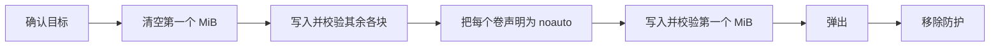

<div align="center">

<h1>kakikomi</h1>

<strong>把磁盘镜像写入软盘、Zip 盘、U 盘和硬盘，逐块校验，并且不让系统挂载它们。</strong>

[English](README.md) | [日本語](README.ja.md) | 简体中文 | [繁體中文 (香港)](README.zh-HK.md)

[](https://github.com/gufranco/kakikomi/actions/workflows/ci.yml)
[](https://github.com/gufranco/kakikomi/releases)
[](LICENSE)
[](#portability)

<p align="center">
  <a href="#quick-start"><strong>快速开始</strong></a> |
  <a href="#never-mounted">绝不挂载</a> |
  <a href="#development">开发</a>
</p>

</div>

一个命令，224 个测试，14 个 shell 模块，除 POSIX 系统外没有任何运行时依赖。`kakikomi` 是日语"書き込み"，意为向磁盘写入数据。它的姊妹工具 [kiyome](https://github.com/gufranco/kiyome) 用来擦除磁盘并检查出错的位线。

---

```console
$ kakikomi debian.img.xz /dev/disk6
Computing the image's SHA-256.

Image:  debian.img.xz
        xz, 16.0 MiB (16777216 bytes)
        SHA-256 dab1a2aef901faed28711e7cfa3fa8ce52cfee0a9b05d71b3d4feb95fb846bb0
Target: /dev/disk6, 16.0 MiB, DISK IMAGE
        Everything on it is replaced, including:
          +16.8 MB disk6

Type disk6 to write, or anything else to stop: disk6
Unmounting /dev/disk6...
Disk unmounted
Measuring /dev/disk6 before writing it, so every limit comes from this disk.
Measured read: 232800 KiB/s sustained, 27ms to reach a sector, allowing 3x that before stopping.
Measured write: 83142 KiB/s sustained, 29ms to reach a sector, allowing 3x that before stopping.
Blanking the first 16.0 MiB so nothing on /dev/disk6 is mountable until the very end.
Writing  50%  86.0 MiB/s  0m00s left
The image holds no volume macOS would mount.
Writing the first 16.0 MiB last.
Writing 100%  34.7 MiB/s  0m00s left
Wrote and verified every chunk of the image.
Reading back all 16.0 MiB to compare with the image.
Validated: /dev/disk6 matches the image, SHA-256 dab1a2aef901faed28711e7cfa3fa8ce52cfee0a9b05d71b3d4feb95fb846bb0
Ejecting /dev/disk6...
Ejected. /dev/disk6 is safe to remove.
```

<a id="quick-start"></a>

## 快速开始

### 前置条件

| 工具 | 用途 | 安装 |
|:-----|:----|:--------|
| POSIX `sh`、`dd`、`cmp`、`od` | 工具本身 | macOS 和 Linux 已预装，不需要 `bash` |
| `gzip`、`xz`、`zstd`、`bzip2` | 压缩镜像 | 仅在写入对应格式时需要 |
| `bsdtar` 或 `7z` | `.zip` 镜像和 Windows ISO | Linux 上为 `libarchive-tools` 或 `p7zip-full` |
| `qemu-img` | `.vhd`、`.vhdx`、`.vmdk`、`.qcow2` | `brew install qemu` 或 `apt install qemu-utils` |
| `mtools`、`wimlib` | Windows ISO 和 `kakikomi format` | 随 Homebrew formula 安装；Linux 上为 `apt install mtools wimtools` |

### 安装

```bash
brew install gufranco/tap/kakikomi
```

也可以从源码安装：

```bash
git clone https://github.com/gufranco/kakikomi.git
cd kakikomi
make install
```

`make install` 把工具、man 手册以及 bash、zsh、fish 补全复制到 `~/.local` 下，并把 `kakikomi` 放进 `~/.local/bin`；设置 `PREFIX` 可以改变位置。Homebrew formula 安装的是同样的文件。

### 验证

```console
$ kakikomi doctor
dd                 ok       /bin/dd
cmp                ok       /usr/bin/cmp
od                 ok       /usr/bin/od
awk                ok       /usr/bin/awk
sed                ok       /usr/bin/sed
sudo               ok       /usr/bin/sudo
sha256sum|shasum   ok       /sbin/sha256sum
diskutil           ok       /usr/sbin/diskutil
hdiutil            ok       /usr/bin/hdiutil
curl               ok       /usr/bin/curl
gzip               ok       /usr/bin/gzip
xz                 ok       /opt/homebrew/bin/xz
zstd               ok       /opt/homebrew/bin/zstd
bzip2              ok       /usr/bin/bzip2
bsdtar|7z          ok       /usr/bin/bsdtar
qemu-img           ok       /opt/homebrew/bin/qemu-img
mcopy              ok       /opt/homebrew/bin/mcopy
wimlib-imagex      ok       /opt/homebrew/bin/wimlib-imagex
```

## 用法

| 命令 | 用途 |
|:--------|:--------|
| `kakikomi [options] <image\|url\|device> [target...]` | 把镜像写入一个或多个磁盘。不指定目标时，列出可选的可移动磁盘 |
| `kakikomi <windows.iso> <target>` | 把 Windows 安装 ISO 布置成可 UEFI 启动的 FAT32 U 盘 |
| `kakikomi format [options] <target> [fat32\|exfat\|fat\|floppy] [LABEL]` | 快速格式化：只写入新文件系统的结构 |
| `kakikomi --release` | 移除某次运行遗留的挂载防护 |
| 不带参数的 `kakikomi` | 在终端中运行时，先询问要做什么，再依次询问每个值 |
| `kakikomi doctor` | 列出 kakikomi 需要的工具以及是否已安装 |
| `kakikomi version`、`kakikomi help` | 显示版本或完整用法 |

| 来源 | 读取方式 |
|:-------|:---------------|
| `.img`、`.iso`、`.bin`、`.raw`、`.dsk`、`.ima` | 直接读取 |
| `.gz`、`.xz`、`.zst`、`.bz2` | 流式读取，从不解压到磁盘 |
| 只含一个镜像的 `.zip` | 用 `bsdtar` 流式读取 |
| `.dmg`、`.vhd`、`.vhdx`、`.vmdk`、`.qcow2` | 检查可用空间后先转换为 raw |
| `http://` 或 `https://` URL | 可续传下载后作为文件读取 |
| `/dev/...`，或 `/Volumes/OLD` 这样已挂载的卷 | 从整个驱动器克隆，该驱动器同样不会被挂载 |

| 选项 | 效果 |
|:-------|:-------|
| `--verify`、`--no-verify` | 最后把整个磁盘与镜像的 SHA-256 比对，或跳过。未指定时在终端中询问 |
| `--delete`、`--no-delete` | 所有磁盘校验通过后把镜像移到废纸篓，或保留。没有回读时忽略 |
| `--again` | 把同一镜像写入你插入的下一个磁盘 |
| `--reinsert`、`--no-reinsert` | 弹出后等待磁盘重新插入并再次比对 |
| `--zero-tail` | 在较大的磁盘上清空镜像之后的空间 |
| `--sha256 HASH` | 镜像不匹配就停止。同目录的 `.sha256` 或 `SHA256SUMS` 文件会自动读取 |
| `--allow-internal` | 允许内置磁盘。运行中系统所在的磁盘始终被拒绝 |
| `--keep-guard` | 运行后保留 fstab 防护，让这台 Mac 永不挂载该磁盘 |
| `--raw` | 按字节原样写入 Windows ISO，而不是布置成 FAT32 |

也可以写成 `--sha256=HASH`，`--` 表示选项结束。环境变量 `VERIFY`、`DELETE`、`AGAIN`、`REINSERT`、`ZERO_TAIL`、`SHA256`、`ALLOW_INTERNAL`、`KEEP_GUARD` 和 `MODE=raw` 以 `y` 或 `n` 设置同样的选项，命令行上的选项优先。

```bash
kakikomi debian.img.xz /dev/disk4 /dev/disk5     # two sticks at once
kakikomi debian.img.xz /Volumes/USB              # a mounted volume stands for its whole disk
kakikomi https://example.org/os.img.gz            # pick the target from a list
kakikomi /dev/disk4 /dev/disk5                    # clone disk4 onto disk5
kakikomi /Volumes/OLD /Volumes/NEW               # the same clone, named by volume
kakikomi --again game.ima /dev/disk6              # a batch of floppies
kakikomi format /dev/disk4 exfat MEDIA
```

磁盘可以用设备名指定，例如 `/dev/disk4`，也可以用它挂载出的任何卷指定，例如 `/Volumes/USB`；kakikomi 会找出卷背后的整个磁盘，来源、目标和 format 命令都一样。

kakikomi 遵循同系列工具共用的命令行约定，详见 [FAMILY.md](FAMILY.md)。

<a id="never-mounted"></a>

## 绝不挂载

macOS 只要挂载 FAT 卷，哪怕只有一瞬间，也会写入 `.fseventsd`、`.Spotlight-V100` 和 `._` 文件，于是为复古机器写好的磁盘拿回来时已经变了。kakikomi 让系统无从下手：



| 步骤 | 细节 |
|:-----|:-------|
| 直到最后都无可挂载 | 第一个 MiB 为空，就没有分区表和引导扇区，DiskArbitration 和 udisks 都找不到卷 |
| 出现之前先声明 | macOS：从用 `-nomount` 挂接的仅含头部的副本读取每个卷的 UUID，以 `noauto` 写入 `/etc/fstab`。Linux：为该设备添加 `UDISKS_IGNORE` udev 规则 |
| 监视 | 运行期间发现挂载即判失败，并列出系统创建的文件 |
| 证明 | `--reinsert` 在你拔插之后回读整个磁盘 |

中途停止的运行会让第一个 MiB 保持空白，所以写到一半的磁盘同样无法挂载。

## 遇到第一个问题就停止

每一块都会写入、回读、比对，然后才处理下一块。kakikomi 先测量磁盘自身的速度，再据此给每次传输设定期限。不匹配、停顿或设备消失都会停止该磁盘、弹出它，并打印出错的位线。

| 驱动器 | 处理方式 |
|:------|:----------|
| Zip、Jaz、PocketZip | 期限更严且不重试；停顿被视为磁头偏离，偏离的磁头会损坏它遇到的下一张盘片 |
| 软盘、SuperDisk | 不重试，并等待你取出磁盘，因为这些驱动器无法用软件弹出 |
| 其他 | 每块尝试三次，然后停止 |

有多个目标时，每个磁盘由独立的 worker 写入，一个出错不会影响其他磁盘。

## Windows 安装盘

按字节原样写入的 Windows ISO 无法从 USB 启动。kakikomi 会识别它，构建一个 MBR 磁盘，其中只有一个容纳全部文件的 FAT32 分区，并用 `wimlib` 拆分超过 4 GiB 的 `install.wim`。文件用 `mtools` 复制，目标从不被挂载，写入卷之前每个文件都会回读比对。结果可以在 UEFI 机器上启动。

<a id="portability"></a>

## 可移植性

全部代码都是 POSIX `sh`，ShellCheck `-o all` 零发现，没有禁用任何检查。测试套件在 macOS 的 `/bin/sh`、`dash`、`bash`、`bash --posix` 和 `zsh` 下运行，也在特权容器中的 Ubuntu 上以相同的 shell 运行。

<a id="development"></a>

## 开发

| 命令 | 说明 |
|:--------|:------------|
| `make lint` | 对每个脚本和补全运行 ShellCheck，用 mandoc 检查 man 手册，并检查没有函数被重复定义 |
| `make test` | 在系统 `sh` 下运行 224 个 `bats` 测试 |
| `make test-all` | 在每个已安装的 shell 下运行同样的测试 |
| `make test-linux` | 从 Mac 在特权 Ubuntu 容器中运行同样的测试 |
| `make coverage` | 在这台 Mac 和同一容器中用 bashcov 测量行覆盖率并合并，CI 要求 100% |

测试用 `hdiutil` 或 `losetup` 挂接以文件为后端的磁盘，真实写入，并在 Linux 上用 `dmsetup` 注入 I/O 错误。CI 在 Ubuntu 和 macOS 上运行。每次推送到 `main` 都会运行 semantic-release：含 `feat` 或 `fix` 提交时会发布 release，更新 [`lib/core.sh`](lib/core.sh) 中的 `KAKIKOMI_VERSION` 和 CHANGELOG，并更新 Homebrew formula。

## 许可证

[MIT](LICENSE)
